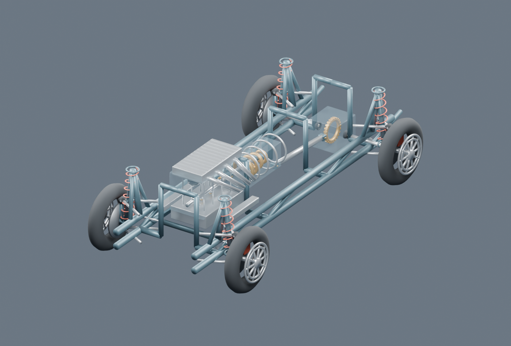
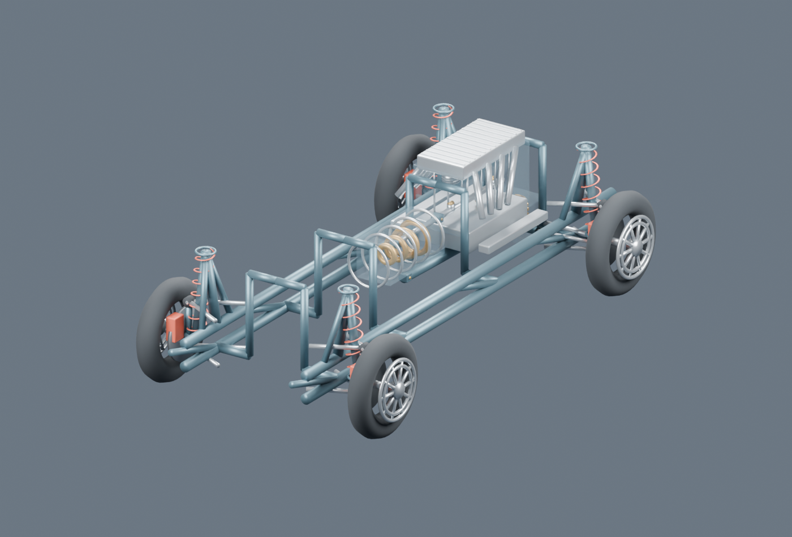
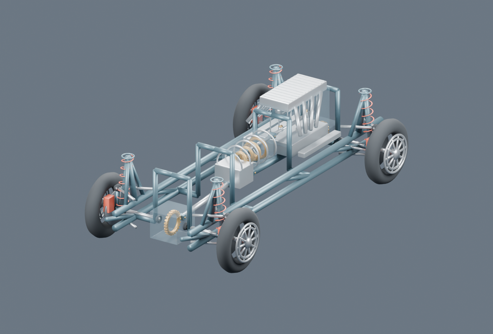

# Game ready car physics

Самостоятельный автомобильный стенд на Godot 4.7.2 / Jolt / 120 Гц. Статус: **development prototype**, не готовый проверенный коммерческий продукт.

Три отдельные компоновки: RWD, FWD и постоянный AWD. Подготовлен запуск сразу на компактный полигон: одиночные/диагональные неровности, гребёнка, рампа и площадка вывешивания. F1 переключает шасси с возвратом на старт.

## Модели

Рычаги соединены с отдельными кулаками внутри ободов, добавлены ступицы, тормозные диски, суппорты, шарниры, опоры пружин и башни амортизаторов. Колёса используют smooth shading. В раме предусмотрен открытый тоннель для кардана. Диапазон хода и зазоры в движении пока не проверены.

- **RWD:** продольный передний двигатель, коробка, кардан, задний дифференциал и задние полуоси. Передних приводных полуосей нет.
- **FWD:** продольный transaxle с передним дифференциалом и передними полуосями; заднего кардана/дифференциала/приводных полуосей нет. Это не поперечная компоновка двигателя.
- **AWD:** передний и задний дифференциалы, четыре полуоси, корпус раздаточного узла и задний кардан; исходное распределение момента 50:50.

Все три конструкции используют проектную двухрычажную подвеску. Они не объявляются точной копией конкретного серийного автомобиля или подвески McPherson.

### RWD

### FWD

### AWD

Это **рендеры Blender, не кадры работающей игры**. Авторская геометрия сцен: RWD 109228, FWD 109320, AWD 135204 треугольника, включая студийные копии и шаблоны деталей. Фактический runtime-бюджет и производительность ещё не измерены.

## Что рассчитывает физика, а что только отображается

| Система | Расчёт, влияющий на движение | Визуальное приближение / ограничения |
|---|---|---|
| Шасси | Масса, инерция, центр масс, силы, контакты RigidBody/Jolt | Трубы рамы не являются независимыми физическими телами |
| Подвеска | Три луча на колесо, сжатие, пружина, демпфер, противодействие крену | Плоский четырёхзвенник рычагов; боковая координата ступицы передаётся лучу. Нет 3D многотельной динамики, втулок и отдельных неподрессоренных тел |
| Шины | Угловая скорость, ограниченное сцепление, продольное/боковое скольжение, разные покрытия | Нет деформации шины, температуры, давления, износа и сил от развала |
| Двигатель | Моментная характеристика, газ, ограничитель, торможение двигателем | Поршни/шатуны/коленвал анимируются от RPM; нет расчёта сгорания и отдельной инерции двигателя |
| Коробка | Передаточные числа, главная пара, ручные/автоматические переключения, R/N | Шестерни демонстрационные, не моделируют зацепление выбранной пары; сцепление приближённое |
| Привод | Распределение момента RWD/FWD/AWD, программные связи дифференциалов | Кардан и полуоси следуют скоростям колёс; нет собственной упругости/инерции валов, контакта зубьев и отказов |
| Тормоза | Тормозной момент и ручник | Геометрия дисков/суппортов, без гидравлики и нагрева |
| Помощники | В коде есть игровые поправки сцепления, стабилизации и нагрузки | Не позиционируется как инженерная модель без игровых допущений |

Рулевые тяги следуют заданным точкам; полноценные caster/toe-кривые, пространственная кинематика руления и податливость креплений пока не реализованы. Часть мелких креплений, пыльников и магистралей упрощена или отсутствует.

## Проверено и не проверено

Выполнены сборка моделей Blender, просмотр студийных рендеров, импорт ресурсов и компиляция сцены редактором Godot. **Не запускались** ездовые проверки, автотест, проверка настоящего геймпада и звук на слух. Полный ход, руление, пересечения, нагрузочные сценарии и производительность требуют практической проверки.

**Публичного exe нет.** По решению владельца Windows-сборки публикуются только в закрытом репозитории. Здесь остаются описание и рендеры. Новая закрытая сборка 0.1.1-dev выполнена без автотестов и без игрового запуска.

## Публикация и коммерческий статус

Здесь только описание и собственные изображения. Исходники, редактируемые модели и инструкции находятся в закрытом репозитории; контент Rally Forever — трассы, меню, музыка, автопарк и карта регионов — не включён. Открытая страница не выдаёт лицензию на закрытый код/модели.

Для будущей продажи подготовлены внутренние инструкции интеграции, реестр происхождения, описание ограничений и список критериев выпуска. Лицензия покупателя, условия поддержки и итоговая проверка пакета ещё не оформлены. Продажи не запущены.

## Обновление 0.1.1-dev — камера
В отдельный проект Game ready car physics перенесена ездовая камера Rally Forever: плавное следование, обзор мышью и правым стиком, автовозврат, умеренная скоростная прибавка дистанции/FOV и проверка препятствий. Зависимости от раллийных трасс и меню убраны. Камера перепривязывается при смене RWD/FWD/AWD и сбрасывается после возврата машины. Импорт/редакторская загрузка/экспорт выполнены; камера в движении не проверена. Новый exe опубликован только в закрытом репозитории. Здесь бинарных файлов и исходников нет.

