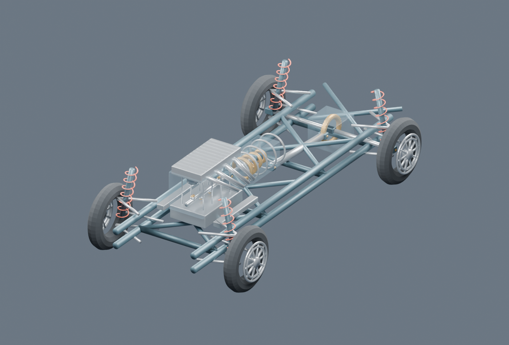
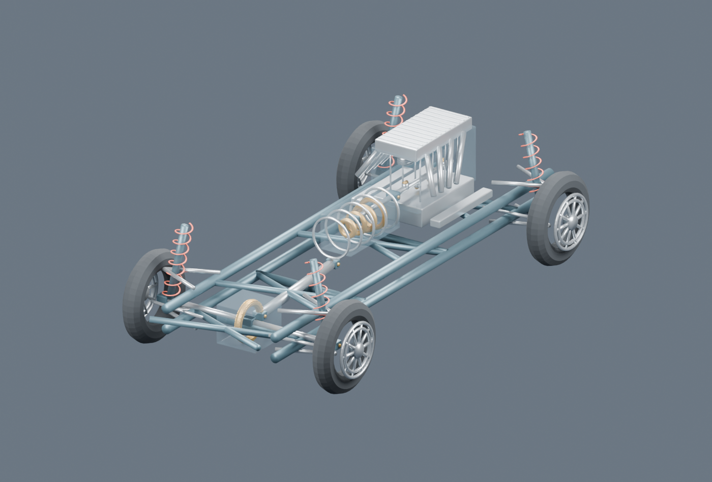

# Game ready car physics

Самостоятельный прототип автомобильной физики на Godot: открытое заднеприводное шасси и компактный полигон с одиночными и диагональными неровностями, гребёнкой, рампой и площадкой вывешивания.

Подготовлены модели двигателя, коробки, кардана, дифференциала и подвески. В коде движение механизмов связано с оборотами двигателя и колёс; подвеска использует лучевой контакт и плоскую кинематическую схему рычагов. Это прототип, а не проверенный инженерный симулятор или полноценный многотельный расчёт.

Изображения выше — рендеры Blender, не скриншоты игрового процесса.

Исходники и редактируемые модели хранятся в закрытом репозитории. Здесь публикуются только описание, изображения и будущие согласованные сборки. Контент Rally Forever — трассы, меню, автопарк, музыка и карта регионов — не включён.

## Текущее состояние

Проверены импорт и компиляция сцены в редакторе Godot. Езда, работа механизмов в движении, настоящий геймпад, звук и производительность пока не проверены.

**Exe пока не опубликован:** на текущий этап согласованы только код и модели. Будущая сборка должна запускаться сразу на полигоне с возможностью езды.
